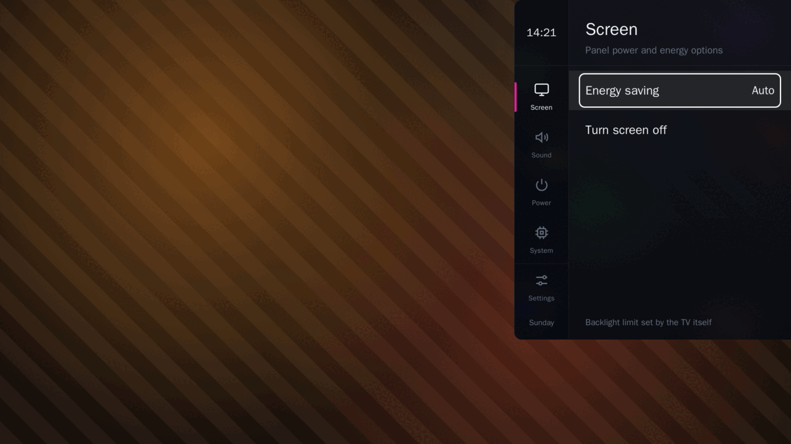

# WebOCU Settings

An overlay settings panel for webOS TV, driven by the TV remote. It stays out of the way of the picture: the video keeps playing under a transparent window while you change the screen, sound, power and system options that the stock menus bury several levels deep.

[](https://github.com/webocu/webocu-settings/actions/workflows/ci.yml)
[](https://github.com/webocu/webocu-settings/releases)
[](LICENSE)


App id: `webocu.settings`



*The panel in a desktop browser. The orange striped background is a stand-in for the TV picture and is never drawn on a TV, where the video shows through.*

## Contents

- [Features](#features)
- [Requirements](#requirements)
- [Install](#install)
- [Usage](#usage)
- [Build from source](#build-from-source)
- [Try it without a TV](#try-it-without-a-tv)
- [Project layout](#project-layout)
- [Documentation](#documentation)
- [Related projects](#related-projects)
- [Contributing](#contributing)
- [Disclaimer](#disclaimer)
- [License](#license)

## Features

**What the panel changes on the TV** (the sections on the rail):

| Section | What it does |
| --- | --- |
| Screen | Energy saving level; turn the screen off while the sound keeps playing (any key wakes it). |
| Sound | Choose the sound output; connect an already paired Bluetooth audio device. |
| Power | Restart or turn off the TV, each behind a confirmation. |
| System | Operating system, device, network and storage information. |
| Settings widget | The panel's own preferences, pinned to the foot of the rail (see below). |

Four more sections are off the rail on a fresh install and can be switched on under **Settings widget → Widgets**: **Eco** (energy-saving levels as one-press actions), **Bluetooth**, **Tweaks** (privileges, application ID, keep-alive, application type) and **Debug** (app and service runtime details).

**What you can change about the panel itself** (Settings widget):

- Theme: dark or light mode, high-contrast theme, accent colour.
- Background pictures for the rows and for the rail, and transparency.
- Panel width, the edge it stands on, and insets above and below it.
- Entrance effect (slide from either side, from the top or the bottom, fade, pop, none).
- Close when idle (5–60 s, 30 s by default) so the panel never keeps the remote from the picture.
- Autostart: what the app does when the TV starts it by itself after boot.
- Clock and date: formats, sizes, accent colour, bold type.
- Which sections the rail carries and in what order; icon captions.
- Where notifications appear.
- Language: Bulgarian, Croatian, English, French, German, Polish, Portuguese, Russian, Serbian, Spanish, Ukrainian, Chinese.

Everything is driven from the remote or the Magic Remote pointer.

## Requirements

- A webOS TV that you can install apps on: **Developer Mode**, or a TV rooted with [webosbrew](https://www.webosbrew.org/).
- To build from source: [Docker](https://docs.docker.com/get-docker/) (Desktop, or engine + Compose v2). There is no local Node.js or webOS CLI requirement; everything runs in containers.

Compatibility: the remote key codes in [`source/js/keys.js`](source/js/keys.js) are documented as verified on webOS TV 4.x–7.x. Other versions and models are untested.

### Privileges

Changing power, sound or Bluetooth settings goes through luna-service and, on most firmwares, needs more rights than a Developer Mode app has. The panel therefore ships a small helper service. At every start, while it has no root, the app asks the [Homebrew Channel](https://github.com/webosbrew/webos-homebrew-channel) (rooted TVs only) to elevate it, silently and without failing if that is not possible. **Tweaks → Request privileges** repeats the request by hand. Without root the panel still works: every call falls back (helper service → Homebrew Channel → the plain luna endpoint), and some rows tell you that they need root.

With root the service also keeps a keep-alive init script in place, which starts the app once after the TV boots (see [Autostart](#autostart-and-closing-when-idle)).

## Install

### From the Homebrew Channel (rooted TV)

1. Open the Homebrew Channel, then **Settings → Add repository**.
2. Enter `https://webocu.github.io/`
3. Open **WebOCU Settings** in the list and press **Install**.

The repository is the catalog of the WebOCU apps ([webocu/webocu.github.io](https://github.com/webocu/webocu.github.io)); the package itself is the `.ipk` of the release below, and the TV checks its hash.

### With the webOS CLI (Developer Mode or root)

Download `webocu.settings_<version>_all.ipk` from the [Releases](https://github.com/webocu/webocu-settings/releases) page and install it with the webOS CLI (`ares-*`):

```sh
ares-install --device <tv> webocu.settings_<version>_all.ipk
ares-launch  --device <tv> webocu.settings
```

On a rooted TV the same package can also be installed with ssh; the Makefile does this for you (see [Build from source](#build-from-source)).

The app can be cloned to another application ID at runtime (**Tweaks → Switch app ID**, needs root). The copy gets its own helper service and its own keep-alive script.

## Usage

Open the app from the launcher. The panel slides in at the edge of the screen; the picture underneath keeps playing.

| Key | On the rail | In the rows |
| --- | --- | --- |
| ▲ ▼ | previous / next section | previous / next row |
| ▶ or OK | go into the section | change the row, open a list or a level |
| ◀ | — | up one level; from the top level, back to the rail |
| Back | leave the app | close an open list, go up one level; from the top level, back to the rail |
| Yellow / `M` on a keyboard | leave the app | leave the app |

The Magic Remote pointer works too: click a row to use it, or the empty area to close the panel.

### Autostart and closing when idle

- **Close when idle** closes the panel and leaves the app after the chosen number of seconds without a key or pointer movement.
- **Autostart** only governs the start the TV makes by itself after boot (the keep-alive init script on a rooted TV). *On*: the panel opens, then goes away by Close when idle. *Off*: the app quits at once, and the next launch is a cold one. A start you make yourself is never affected.

## Build from source

Docker is the only host requirement.

```sh
make            # list all targets
make check      # lint + smoke test + .ipk (smoke has known failures, see CONTRIBUTING.md)
make build      # build dist/webocu.settings_<version>_all.ipk
make dev        # static server on http://localhost:8080
```

Install and launch on a TV:

```sh
# Developer Mode
make tv-add TV=192.168.1.50 NAME=tv     # Developer Mode must be on
make tv-key NAME=tv
make tv-use-tv
make build deploy

# Rooted with webosbrew (sshd on port 22)
make tv-add-root TV=192.168.1.51 NAME=tv2
make tv-use-tv2
make build deploy
```

The full list of targets, the device profiles and the version bumping rules are in [CONTRIBUTING.md](CONTRIBUTING.md).

## Try it without a TV

`make dev` serves the app on <http://localhost:8080>, and every state is reachable from the query string, so the panel can be developed and checked in a desktop browser:

```
http://localhost:8080/?section=system&theme=light&accent=azure
http://localhost:8080/?confirm=restart
http://localhost:8080/?keys=down,down,enter
```

`make shots` writes 1920×1080 screenshots of the main states to `test/shots/`, and `make smoke` runs a headless Chromium check. The list of parameters is the comment block at the end of [`source/js/app.js`](source/js/app.js).

## Project layout

```
source/             the app, as installed on the TV
  index.html        entry page; scripts load in a fixed order
  js/               plain ES5: keys, i18n, luna, platform, store, settings, dialog, menu, app
  locales/          one file per language (en is required)
  css/, img/        styles and artwork
  service/          privileged helper service (Node, ES5)
  tweaks/           shell scripts the helper service uses on a rooted TV
tools/              Docker image, lint, smoke test, packaging, install scripts
misc/               README preview
dist/               built .ipk files (not tracked)
```

There is no framework and no bundler: each script publishes one global. Features are declared in [`source/js/settings.js`](source/js/settings.js); adding an option touches that file and the locale files and nothing else.

## Documentation

- [START_FLOW.md](START_FLOW.md): how the app starts, how it talks to the helper service, every service endpoint.
- [STORAGE_ARCHITECTURE.md](STORAGE_ARCHITECTURE.md): where each setting lives and how it is applied.
- [CONTRIBUTING.md](CONTRIBUTING.md): development workflow, conventions, `make` reference.
- [CHANGELOG.md](CHANGELOG.md), [SECURITY.md](SECURITY.md), [THIRD_PARTY_NOTICES.md](THIRD_PARTY_NOTICES.md).

## Related projects

- [WebOCU Dock](https://github.com/webocu/webocu-dock): an overlay app launcher in the same style (`webocu.dock`).
- [webocu.github.io](https://github.com/webocu/webocu.github.io): the Homebrew Channel catalog with both apps.

## Contributing

Issues and pull requests are welcome. Please read [CONTRIBUTING.md](CONTRIBUTING.md) first; `make lint` and `make build` have to pass. To report a security problem, see [SECURITY.md](SECURITY.md).

## Disclaimer

WebOCU Settings is an independent project. It is not affiliated with, endorsed by or sponsored by LG Electronics. webOS and LG are trademarks of their respective owners.

The helper service and the keep-alive script run with root rights on a rooted TV and change system settings, restart or power off the TV. Use them at your own risk. The software is provided as is, without warranty of any kind (see [LICENSE](LICENSE)).

Thanks to the [webosbrew](https://www.webosbrew.org/) community for the Homebrew Channel and the research that makes rooted webOS TVs approachable.

## License

[MIT](LICENSE) © 2026 etix
